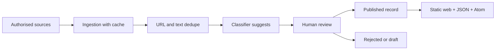

# Zona Gris · Open atlas of hybrid incidents

[](https://github.com/mcasrom/zona-gris-atlas/actions/workflows/ci.yml)
[](LICENSE)

> **Visible warning:** the demonstration data on the website is **not real**. Every record has `demo: true` and an “Illustrative example” label. It does not describe real incidents, actors or organisations.

An open atlas of gray-zone and hybrid-threat incidents. It records the event, its source and **who attributes it**. The system does not attribute authorship on its own.

## What it is, and what it is not

**It is** a dated record across eight domains: cyber, critical infrastructure, airspace and drones, GNSS interference, physical sabotage, disinformation, economic coercion and migration instrumentalisation.

**It is not** an automatic attribution engine, an attack predictor, a people profiler or a real-time intelligence base. Submarine cables are outside v0.1.

## Attribution principle

Attribution is a datum, not the system's conclusion. Each record keeps one of three states: `none`, `official` or `claimed`. It also stores who attributes, the source type, the source URL, a confidence level and a quote of at most 15 words. “Unattributed” is a valid and frequent result.

## Scale and taxonomy

The full scale runs from `paz_estable` to `conflicto_abierto`. This atlas covers only the middle: `competencia`, `zona_gris` and `hostilidad_hibrida`.

Domains: `CIB`, `INF`, `AER`, `GNS`, `SAB`, `DES`, `ECO`, `MIG`.

## Pipeline



## Current state

- **Phase 0 — laptop:** repository, schema, minimal pipeline, evaluation and static site.
- **Phase 1 — server:** pending; nothing is deployed in this session.
- **Phase 2 — publication:** pending domain, data licence and source review.

The site uses **10 demonstration incidents**. The classifier never publishes: the gate requires a macro F1 ≥ 0.75 over a gold set of at least 200 events.

## Quick start

```bash
make setup
make lint
make test
make web
make serve
# http://localhost:8080
```

Commands: `setup`, `lint`, `test`, `ingest`, `classify`, `export`, `web`, `serve`, `backup`.

## Backup

GitHub is the primary copy. The local bundle is the second:

```bash
make backup
# ~/backups/zona-gris-atlas/zona-gris-atlas-<timestamp>.bundle
```

Daily cron example:

```cron
15 3 * * * cd /home/miguelc/Desktop/zona-gris-atlas && ./scripts/backup.sh >> "$HOME/backups/zona-gris-atlas/backup.log" 2>&1
```

The last **10** bundles are kept.

## Evaluation

`eval/metrics.py` computes precision, recall, per-class F1, macro F1 and the confusion matrix. The current threshold is `0.75` with a minimum of `200` gold events; both are pending decisions. Until they are met, the classifier only suggests.

## Sources and licences

See `config/sources.yaml`. **All sources are `enabled: false`** and their licence is `[DECIDIR]`. No paid APIs, no cookies, no trackers and no remote Google Fonts.

## Limits

Read [`docs/LIMITES.md`](docs/LIMITES.md): no self-attribution, no prediction, no judging people and no submarine cables in v0.1.

## Contributing

Read [`CONTRIBUTING.md`](CONTRIBUTING.md). Open an issue with the relevant template. Do not include personal data or secrets.

## License

Code under **AGPL-3.0** (see [`LICENSE`](LICENSE)). The data licence is pending: `[DECIDIR: CC BY 4.0]`.

## Relationship with FIMI Radar

FIMI Radar measures network diffusion. Zona Gris measures **real-world events**. They do not share code.
