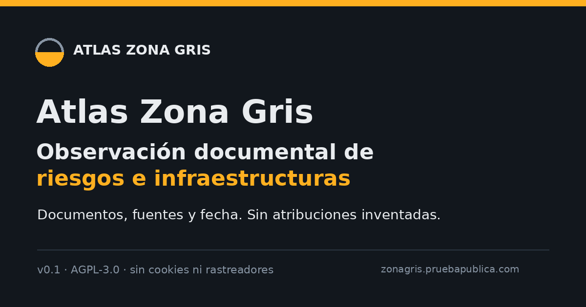
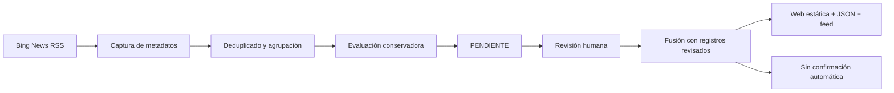

# Zona Gris · Observatorio documental de infraestructura crítica

[](https://github.com/mcasrom/zona-gris-atlas/actions/workflows/ci.yml)
[](LICENSE)

> **Aviso visible:** el mapa público contiene registros documentados y candidatos automáticos. Los candidatos llevan `PENDIENTE` y no se presentan como incidentes confirmados. El baseline de aeropuertos es una capa aparte, en N1 inicial; no es un censo ni una atribución.

Atlas Zona Gris es un **observatorio documental de incidentes en infraestructura crítica**. Registra fecha, lugar documentado, categoría, estado de verificación y enlace a la fuente original. El sistema **no atribuye autoría ni intención** por su cuenta.



## Qué es y qué no es

**Es** un registro fechado de acontecimientos documentados y candidatos automáticos en aeropuertos, ferrocarril, ciberseguridad, GNSS, energía, telecomunicaciones y protección civil.

**No es** un atribuidor automático, un predictor de ataques, un perfilador de personas ni una base de inteligencia en tiempo real. Las alertas, amenazas y reivindicaciones se conservan como tales; no se convierten en ataques confirmados.

## Hito 10-nov-2026: de recolector a observatorio documental

- **Subtítulo público:** Observatorio documental de incidentes en infraestructura crítica.
- **Aeropuertos: N1 inicial.** **65 eventos · 24 meses · 57 dominios**, con baseline v1.7 congelado y SHA-256.
- **Episodios auditados:** 2 seguimientos retirados del conteo; siguen trazables en `data/baseline/airports-followups.csv`.
- **Corroboración:** **63 eventos** con segunda fuente directa; **2 solo documentados**. Una fuente no se presenta como corroboración.
- **N2 descriptivo:** con **57 eventos / 23 meses completos**, mediana 2 y p90 5; **2025-12** es el único mes completo por encima del p90 (6 eventos). **2026-10** queda en 5; **2026-11** no se compara por ser parcial.
- **Página pública:** [`/baseline-aeropuertos.html`](https://zonagris.pruebapublica.com/baseline-aeropuertos.html) y [`/alcance.html`](https://zonagris.pruebapublica.com/alcance.html).
- **Caso público:** [`/caso-moscu-aeropuertos.html`](https://zonagris.pruebapublica.com/caso-moscu-aeropuertos.html) — cuatro episodios, recurrencia en la muestra y ningún atajo a campaña. Documento: [`docs/CASO-AEROPUERTOS-MOSCU.md`](docs/CASO-AEROPUERTOS-MOSCU.md).
- **GNSS: N0.** Inventario **v0.1** de **30 episodios** documentados (**24 en ventana de 24 meses**) y **4 agregados**; **no hay N1** ni frecuencia publicable.
- **Límite:** N1/N2 son descriptivos. No hay atribución, campaña ni tendencia consolidada; N3 no está abierto.

## Principio de atribución

La atribución es un dato, no una conclusión. Cada ficha distingue:

- `none`: sin atribución pública verificable. Es un valor válido y frecuente.
- `official`: un gobierno, una agencia o una empresa técnica atribuye el hecho.
- `claimed`: un grupo reivindica el hecho, sin que eso equivalga a prueba independiente.

Se guarda **quién** atribuye (`attributed_by`), **qué tipo** de fuente es (`government`, `agency`, `vendor`, `other`), su URL, el nivel de confianza (`low`, `medium`, `high`) y una cita de máximo 15 palabras. **El sistema no rellena un hueco por inferencia.**

## Escala y taxonomía

La escala completa va de `paz_estable` a `conflicto_abierto`. El atlas cubre solo el centro:

| Código | Dominio | Una línea |
|---|---|---|
| CIB | Ciber | Intrusiones, phishing, ransomware y operaciones contra sistemas. |
| INF | Infraestructura crítica | Energía, agua, transporte, sanidad o telecomunicaciones. |
| AER | Espacio aéreo y drones | Incursiones, cierres, drones hostiles y alertas. |
| GNS | Interferencia GNSS | Interferencia o suplantación de GPS y Galileo. |
| SAB | Sabotaje físico | Daños deliberados a instalaciones o equipos. |
| DES | Desinformación | Operaciones coordinadas para alterar la percepción. |
| ECO | Coerción económica | Presión comercial, energética o financiera. |
| MIG | Instrumentalización migratoria | Uso político de flujos migratorios. |
| CAB | Cables submarinos | Cortes o daños en cables submarinos de comunicaciones o energía. |
| IAA | Ataques con IA | Uso de IA para atacar sistemas o infraestructuras; no toda mención de IA. |

## Cómo funciona



La captura automática consulta **Bing News RSS** (registrado como agregador de
descubrimiento en `config/sources.yaml`), conserva titulares, resumen corto, URL,
fecha y huella SHA-256. Ningún candidato automático pasa a `DOCUMENTADO`: una o
varias fuentes lo dejan en `PENDIENTE` hasta la revisión humana. El constructor
degrada también los registros antiguos sin revisión. Los registros revisados tienen
prioridad en la fusión. Detalle: [`docs/AUTO-INGESTA.md`](docs/AUTO-INGESTA.md).

La portada combina un **mapa compacto**, los últimos incorporados y un
**microcronograma de eventos por día** (últimos 8 días). Ese gráfico cuenta fechas
de acontecimientos, **no ejecuciones de ingesta**. La lista del mapa usa **dos
columnas con scroll propio** en escritorio y una columna en móvil. Los marcadores
solo aparecen cuando hay una ciudad o región documentada; los demás registros
quedan en la lista.

La captura automática descarta análisis, previsiones, obras, posts virales,
declaraciones y titulares de contexto o agregados (cumbres, "calls for",
"sets out", "wave of"), además de agregadores de baja calidad; agrupa titulares
del mismo episodio y bloquea dominios que no aportan una fuente verificable. La matriz pública se genera desde
el mismo `events.json` que el mapa, de modo que portada, mapa y API comparten un
único total. El fallback sin JavaScript se actualiza desde esa misma captura.

## Estado actual

- **Publicado en Hetzner:** `https://zonagris.pruebapublica.com`.
- **Estado del registro público (12-nov):** **15 eventos**, **15 documentados** y **0 pendientes**, con mapa, matriz/API y fallback compartiendo el mismo total.
- **Baseline de aeropuertos (capa separada):** **65 eventos / 24 meses**, **63 corroborados** y **2 documentados**; `data/baseline/airports-baseline-v1.7.json` congelado con SHA-256.
- **N2 aeropuertos:** **57 eventos / 23 meses completos**; mediana 2, p90 5; solo **2025-12** (6) por encima. 2026-11 es parcial y queda fuera.
- **Release actual:** consultar `current`; las releases anteriores se conservan para rollback.
- **Captura automática:** cron cada 6 horas; Bing News RSS como descubrimiento, matriz regional de consultas y capa primaria separada.
- **Capa primaria:** `/primarias.html` · CERT-EU, JPCERT/CC, CERT.br, NCSC-UK, EASA y CERT-FR; **155 documentos**, no incidentes.
- **Cobertura:** `/cobertura.html` · separa ámbito de consulta, candidatos y registros con ubicación documentada.
- **Geolocalización:** `--geo-shadow` calcula sugerencias sin publicarlas; no está activa en producción.
- **Resumen semanal:** `/suscribirse.html` · lista propia con doble opt-in, Resend y baja en un clic; no se mezcla con otras listas.
- **Automatización:** un fallo de captura no cambia `current`; las releases anteriores
  se conservan para rollback. La capa primaria falla de forma aislada: no tumba el mapa.

## Arranque rápido

```bash
make setup
make lint
make test
make events       # captura automática
make web
make serve
# http://localhost:8080
```

Comandos disponibles: `setup`, `lint`, `test`, `events`, `ingest`, `classify`, `export`, `web`, `serve`, `backup`.

Para la ingesta GDELT, primero revisa sus condiciones y configura `--query`:

```bash
.venv/bin/python -m zonagris.cli initdb
.venv/bin/python -m zonagris.cli ingest --source gdelt --query "drones europa"
```

No hay claves en el repo. Copia `.env.example` a `.env` solo si lo necesitas.

## Copia de seguridad

GitHub es la copia principal. El servidor conserva las releases. El bundle del
portátil es opcional:

```bash
make backup
# ~/backups/zona-gris-atlas/zona-gris-atlas-<fecha>.bundle
```

Para programarlo cada día a las 03:15:

```cron
15 3 * * * cd "$HOME/zona-gris-atlas" && ./scripts/backup.sh >> "$HOME/backups/zona-gris-atlas/backup.log" 2>&1
```

Se conservan los últimos **10** bundles.

## Estructura

```text
config/       taxonomía, fuentes, sitio, matriz de consultas y países
db/           esquema SQLite
docs/         método, límites, atribución, geolocalización, privacidad
src/zonagris/ ingesta, deduplicado, clasificación, exportación y CLI
eval/         métricas opcionales
web/          HTML, CSS, JS, fuentes, mapa, incidentes, cobertura y primarias
deploy/       systemd, nginx y Dockerfile
scripts/      captura, capa primaria, resumen semanal, backup, build_web y OG
```

## Evaluación y criterios de salida

`eval/metrics.py` permite medir una muestra si alguien quiere hacerlo, pero **no
hay puerta de publicación ni se exige un etiquetado masivo**. El clasificador es
experimental y no publica fichas. La revisión humana es por ficha, no un lote
masivo de etiquetado. No hay fichero de umbral ni conjunto de validación obligatorio.

## API de incidentes

- `GET /api/atlas/incidentes?limit=50&cursor=...` — matriz paginada con cursor estable, filtros `domain`, `status`, `attribution`, `days` y `q`; devuelve `total`, `next_cursor`, `counts` y facetas.
- `GET /api/atlas/incidentes.csv?domain=...&status=...` — descarga CSV con los mismos filtros, sin cursor.
- La tabla pública usa **50 filas por página**, botones anterior/siguiente y descarga CSV; los filtros se resuelven en el servidor.

## Calidad de datos y análisis interno

La capa interna vive en `data/quality/` y **no se publica**:

- `quality_report.py`: normalización, deduplicado TF-IDF, canónicos y propuestas de corrección.
- `review.json`: 13 correcciones aceptadas y 17 rechazadas/pendientes de 30.
- `graph_report.py` y `graph_temporal.py`: grafo de co-ocurrencia y grafo temporal.
- `campaign_report.py`: campañas/oleadas sugeridas con entidades compartidas.
- `baseline_snapshot.py`: foto diaria para construir línea base histórica.

Estado actual: el baseline de aeropuertos tiene **65 eventos en 24 meses**, **57 en 23 meses completos**, **63 corroborados** y **2 documentados**. La base v1.7 está congelada; las campañas internas siguen siendo hipótesis, no atribuciones.

El cron `45 8 * * *` guarda la foto diaria en el servidor. N2 solo se interpreta como patrón descriptivo; **no se abre N3** con esta base.

## Fuentes y licencias

La captura automática usa **Bing News RSS** como descubrimiento. La **capa primaria**
usa CERT-EU, JPCERT/CC, CERT.br y NCSC-UK; se muestran como documentos, no como
incidentes. Bing no se presenta como fuente primaria y no se publica el artículo
completo. No hay APIs de pago, claves de proveedores ni cookies. La lista y las
pruebas de fuentes están en `config/sources.yaml`, `data/events/auto/sources.json`
y `data/events/primary/documents.json`.

## Límites y ética

El detalle está en [`docs/LIMITES.md`](docs/LIMITES.md). En resumen: no atribuye por su
cuenta, no predice, no juzga personas. Cables submarinos e IA tienen categoría propia,
con criterios estrictos y sin atribución por inferencia.
También se declaran el sesgo de la dieta de fuentes y el criterio estricto de la
categoría **MIG**: no todo flujo migratorio es instrumentalización.

Lección de cobertura: [`docs/LECCION-AMERICA-ASIA.md`](docs/LECCION-AMERICA-ASIA.md).
América y Asia no están vacías: están fuera de la matriz de fuentes actual. Ese
documento separa hipótesis externas de fichas verificadas y fija qué falta.

## Seguridad

La política de divulgación está en [`SECURITY.md`](SECURITY.md). No abras una
issue pública con una vulnerabilidad explotable.

## Cómo contribuir

Lee [`CONTRIBUTING.md`](CONTRIBUTING.md), abre una issue con la plantilla adecuada y no incluyas datos personales ni secretos. Las correcciones de fichas son bienvenidas.

## Licencia

Código bajo **AGPL-3.0** (ver [`LICENSE`](LICENSE)). Los datos propios
(estructura, metadatos y notas editoriales) se publican bajo **CC BY 4.0**; los
titulares y artículos de terceros conservan sus derechos y solo se enlazan. Ver
[`DATA-LICENSE.md`](DATA-LICENSE.md).

## Relación con FIMI Radar

FIMI Radar mide difusión en redes. Zona Gris mide **eventos del mundo real**. No comparten código. Enlaces: [FIMI Radar](https://fimi.viajeinteligencia.com/) · [viajeinteligencia.com](https://viajeinteligencia.com/).

## Pendientes

- Revisar periódicamente las condiciones de uso de Bing News RSS y de las fuentes
  institucionales.
- Mantener la revisión editorial antes de promocionar cualquier registro a
  `DOCUMENTADO` o `CONFIRMADO`; la automatización no toma esa decisión.
- Vigilar el log del cron y la antigüedad de la última captura.
- Medir una muestra solo si hay una pregunta concreta; no se exige ni se espera una validación masiva.
- Revisar la dieta de fuentes y documentar la incorporación de fuentes no
  occidentales; el registro actual no es geográficamente neutral.
- No activar `--geo` hasta que las sugerencias del modo sombra tengan una tasa de
  error aceptable y exista metadata de país fiable.
