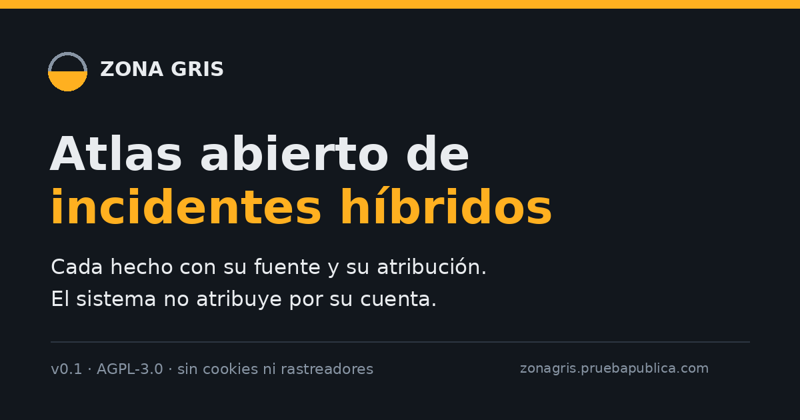
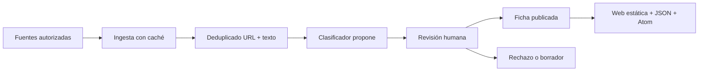

# Zona Gris · Atlas abierto de incidentes híbridos

[](https://github.com/mcasrom/zona-gris-atlas/actions/workflows/ci.yml)
[](LICENSE)

> **Aviso visible:** los datos de demostración de la web **no son reales**. Llevan `demo: true` y la etiqueta «Ejemplo ilustrativo». No describen incidentes, autores ni organizaciones reales.

Atlas abierto de incidentes de zona gris y amenazas híbridas. Registra el hecho, su fuente y **quién atribuye**; el sistema no atribuye autoría por su cuenta.



## Qué es y qué no es

**Es** un registro fechado de incidentes en ocho dominios: ciber, infraestructura crítica, espacio aéreo y drones, interferencia GNSS, sabotaje físico, desinformación, coerción económica e instrumentalización migratoria.

**No es** un atribuidor automático, un predictor de ataques, un perfilador de personas ni una base de inteligencia en tiempo real. Los cables submarinos quedan fuera de la v0.1.

## Principio de atribución

La atribución es un dato, no una conclusión. Cada ficha distingue:

- `none`: sin atribución pública verificable. Es un valor válido y frecuente.
- `official`: un gobierno, una agencia o una empresa técnica atribuye el hecho.
- `claimed`: un grupo reivindica el hecho, sin que eso equivalga a prueba independiente.

Se guarda **quién** atribuye (`attributed_by`), **qué tipo** de fuente es (`government`, `agency`, `vendor`, `other`), su URL, el nivel de confianza (`low`, `medium`, `high`) y una cita de máximo 15 palabras. **El sistema no rellena un hueco por inferencia.**

## Escala y taxonomía

La escala completa va de `paz_estable` a `conflicto_abierto`. El atlas cubre solo el centro:

| Código | Dominio | Una línea |
|---|---|---|
| CIB | Ciber | Intrusiones, phishing, ransomware y operaciones contra sistemas. |
| INF | Infraestructura crítica | Energía, agua, transporte, sanidad o telecomunicaciones. |
| AER | Espacio aéreo y drones | Incursiones, cierres, drones hostiles y alertas. |
| GNS | Interferencia GNSS | Interferencia o suplantación de GPS y Galileo. |
| SAB | Sabotaje físico | Daños deliberados a instalaciones o equipos. |
| DES | Desinformación | Operaciones coordinadas para alterar la percepción. |
| ECO | Coerción económica | Presión comercial, energética o financiera. |
| MIG | Instrumentalización migratoria | Uso político de flujos migratorios. |

## Cómo funciona



Cada paso está documentado en [`docs/METODOLOGIA.md`](docs/METODOLOGIA.md). La atribución tiene su propia página: [`docs/ATRIBUCION.md`](docs/ATRIBUCION.md).

## Estado actual

- **Fase 0 — portátil:** repo, esquema, pipeline mínimo, evaluación y web estática.
- **Fase 1 — servidor:** pendiente; no se despliega nada en esta sesión.
- **Fase 2 — publicación:** pendiente de dominio, licencia de datos y revisión de fuentes.

La web usa **10 incidentes de demostración**. El clasificador **no publica nada**: la puerta exige F1 macro ≥ 0,75 sobre un conjunto de oro de al menos 200 eventos.

## Arranque rápido

```bash
make setup
make lint
make test
make web
make serve
# http://localhost:8080
```

Comandos disponibles: `setup`, `lint`, `test`, `ingest`, `classify`, `export`, `web`, `serve`, `backup`.

Para la ingesta GDELT, primero revisa sus condiciones y configura `--query`:

```bash
.venv/bin/python -m zonagris.cli initdb
.venv/bin/python -m zonagris.cli ingest --source gdelt --query "drones europa"
```

No hay claves en el repo. Copia `.env.example` a `.env` solo si lo necesitas.

## Copia de seguridad

GitHub es la copia principal. El bundle local es la segunda:

```bash
make backup
# ~/backups/zona-gris-atlas/zona-gris-atlas-<fecha>.bundle
```

Para programarlo cada día a las 03:15:

```cron
15 3 * * * cd /home/miguelc/Desktop/zona-gris-atlas && ./scripts/backup.sh >> "$HOME/backups/zona-gris-atlas/backup.log" 2>&1
```

Se conservan los últimos **10** bundles.

## Estructura

```text
config/       taxonomía, fuentes y sitio
db/           esquema SQLite
docs/         método, límites, atribución, evaluación, arquitectura, privacidad
src/zonagris/ ingesta, deduplicado, clasificación, exportación y CLI
eval/         formato de oro, métricas y umbral
web/          HTML, CSS, JS, fuentes y datos demo
deploy/       systemd, nginx y Dockerfile
scripts/      backup, build_web, mapa y OG
```

## Evaluación y criterios de salida

`eval/metrics.py` calcula precisión, recall, F1 por clase, F1 macro y matriz de confusión. La puerta está en `eval/threshold.yaml`:

- `min_macro_f1: 0.75` **[DECIDIR]**
- `min_gold_events: 200`

Mientras no se cumpla, el clasificador solo propone y nunca publica.

## Fuentes y licencias

La lista prevista está en `config/sources.yaml`. **Todas las fuentes están `enabled: false`** y con licencia `[DECIDIR]`. No hay APIs de pago. No se usan cookies, rastreadores ni Google Fonts remoto.

## Límites y ética

El detalle está en [`docs/LIMITES.md`](docs/LIMITES.md). En resumen: no atribuye por su cuenta, no predice, no juzga personas y no cubre cables submarinos en la v0.1.

## Cómo contribuir

Lee [`CONTRIBUTING.md`](CONTRIBUTING.md), abre una issue con la plantilla adecuada y no incluyas datos personales ni secretos. Las correcciones de fichas son bienvenidas.

## Licencia

Código bajo **AGPL-3.0** (ver [`LICENSE`](LICENSE)). La licencia de los datos queda pendiente: `[DECIDIR: CC BY 4.0]`.

## Relación con FIMI Radar

FIMI Radar mide difusión en redes. Zona Gris mide **eventos del mundo real**. No comparten código. Enlaces: [FIMI Radar](https://fimi.viajeinteligencia.com/) · [viajeinteligencia.com](https://viajeinteligencia.com/).

## Decisiones pendientes

- `[DECIDIR: dominio]`
- `[DECIDIR: nombre público del autor]`
- `[DECIDIR: contacto]`
- `[DECIDIR: KOFI_URL]`
- `[DECIDIR: licencia de los datos, propuesta CC BY 4.0]`
- `[DECIDIR: condiciones de uso de cada fuente]`
- `[DECIDIR: umbral F1 y tamaño del conjunto de oro]`
- `[DECIDIR: política de retención de textos crudos]`
